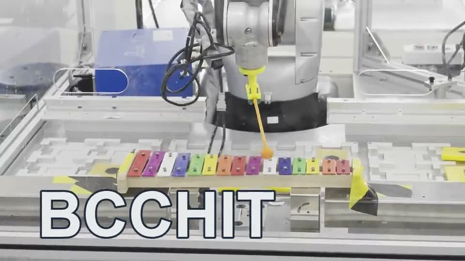

# 六轴机械臂木琴演奏

**Xylophone Robot Motion Planning** · HL-0905 / MATLAB / Simulink / 运动学 / LFPB

从音符和节拍出发，生成机械臂敲击关键点、连续关节轨迹和控制器点位文件。项目保留笛卡尔空间与关节空间两套方案，记录从运动学建模到真机演奏的过程。



**[▶ 播放真机演奏视频（保留声音）](https://github.com/user-attachments/assets/afda2fef-93ba-43cd-b256-202cc22fe093)**

## 项目概览

机器人学导论团队课程设计，使用 HL-0905 六轴机器人、15 键木琴与击槌。完成建模、运动学、轨迹规划和上机调试。

历史项目材料记录真机演奏《天空之城》《小星星》《虫儿飞》等曲目。当前代码的方案二默认乐谱为《天空之城》简化片段。

## 两套方案与工程取舍

| | 方案一：笛卡尔空间 | 方案二：关节空间 |
| --- | --- | --- |
| 主入口 | `run_xylophone_project.m` | `run_scheme2_project.m` |
| 起点 | 实测琴键坐标、固定末端姿态 | 15 键示教关节角 |
| 关键点 | safe → hit → lift 的空间位姿 | 对示教点作 FK，再对局部关键点求 IK |
| 插补 | 笛卡尔 LFPB，再逐采样点 IK | 关键点之间做关节 LFPB |
| 连续性 | 多解筛选、接近上一时刻的分支 | 局部选解并保留连续角度 |
| 取舍 | 路径几何直观，逐点求解成本较高 | 面向示教姿态，木琴移动后需重新标定 |

方案二通过局部关键点的正逆运动学计算与关节空间插补，减少密集逐点求逆。

## 从乐谱到执行文件

```text
notes / beats / BPM
        ↓
琴键标定 → safe / hit / lift 准备、敲击、回弹关键点
        ↓
方案一：空间 LFPB → 逐点 IK → 连续选解
方案二：局部 FK/IK → 关节 LFPB
        ↓
关节轨迹 q → 速度/加速度诊断 → PPB 点位文件
        ↓
Simulink 检查与历史真机演奏
```

## 实机效果

https://github.com/user-attachments/assets/afda2fef-93ba-43cd-b256-202cc22fe093

## 值得关注的实现

- **运动学与选解**：`Fkine.m`、`Ikine6s_all.m`、`SelectIKSolution.m`；保留第六轴的连续角度分支，避免人为制造约 360° 跳变。
- **节拍与轨迹**：`LFPBScalar.m` 及两套采样器按时间戳插补，形成加速、匀速和减速三段运动。
- **敲击动作**：每个音符构造准备、敲击、回弹关键点，控制接近高度与击键深度。
- **诊断与导出**：输出轨迹及关节角、速度、加速度曲线；PPB 文件不带时间列，历史配置按 1 ms/行生成。

## 快速开始

在 MATLAB 中将当前目录切换到本仓库根目录，然后选择一个入口：

```matlab
run_scheme2_project     % 方案二：示教关节角 + 关节 LFPB
% 或 run_xylophone_project
```

运行前在 `RobotConfig_HL0905.m` 和 `Scheme2KeyMap.m` 中核对机器人尺寸、TCP 偏置与琴键标定。可先运行 `VerifyKinematics` 检查正逆运动学。

运行输出写入 `output/`。打开 `models/HL0905_2.slx`，使用工作区中的 `t, q, qd, qdd` 进行仿真。方案二的乐谱入口是 `Song_Scheme2Placeholder.m`，当前内容为《天空之城》简化片段。

上机前需匹配标定位置和控制器采样周期（当前配置为 1 ms），并检查关节限位及运动路径。

## 文件组织

```text
*.m                       保持原 MATLAB 路径与两个主入口
models/                   原 Simulink 模型（单一版本）
data/calibration/         两轮真机琴键测量数据
examples/historical/      实验输出与诊断图
assets/                   BCCHIT 水印视频、封面与 GIF
output/                   运行生成，默认不纳入版本管理
```
